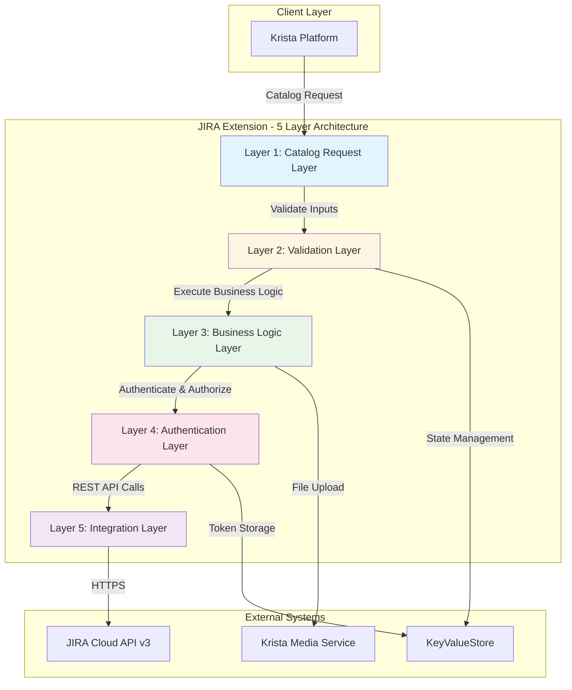
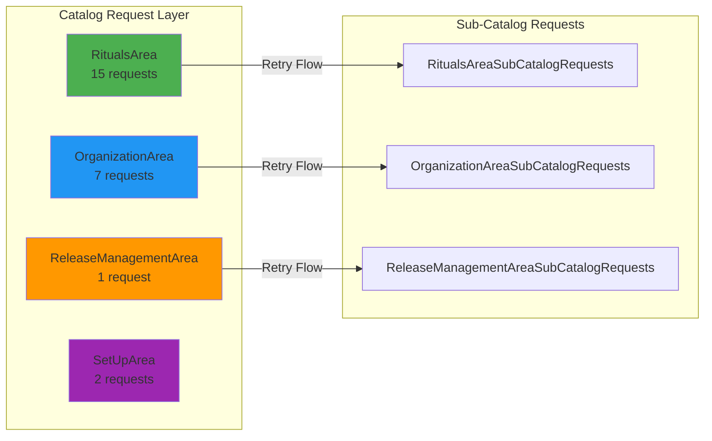
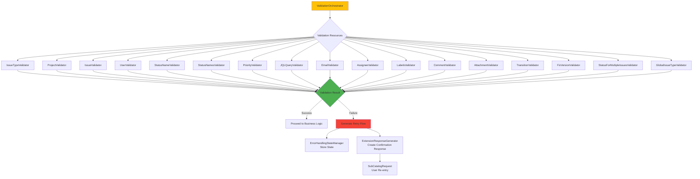
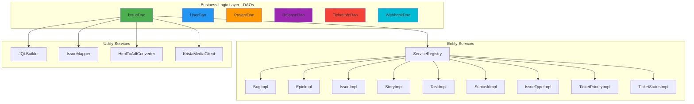
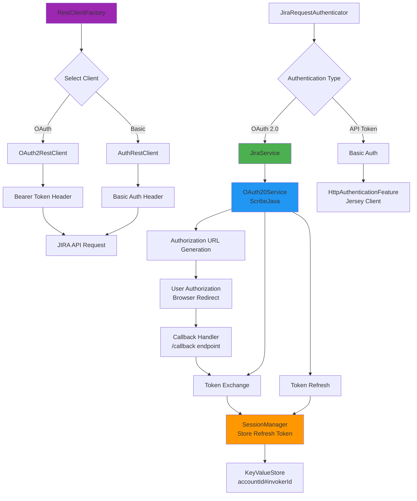
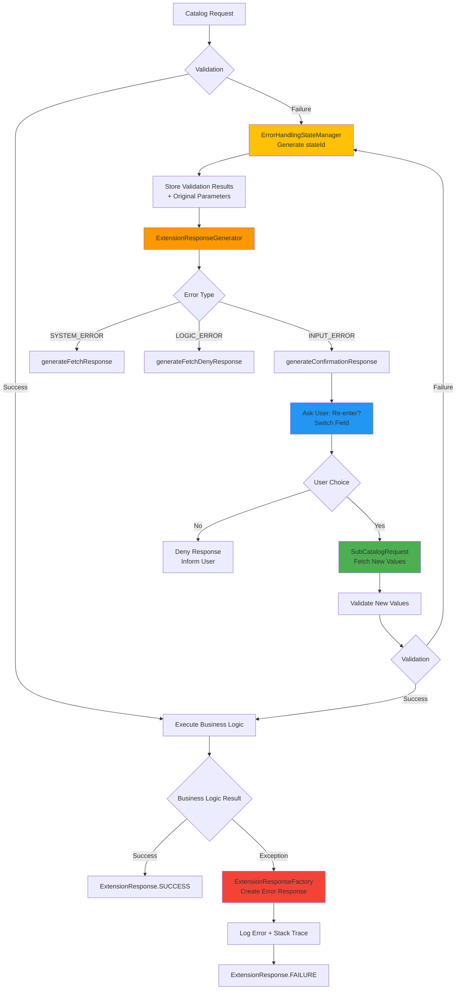
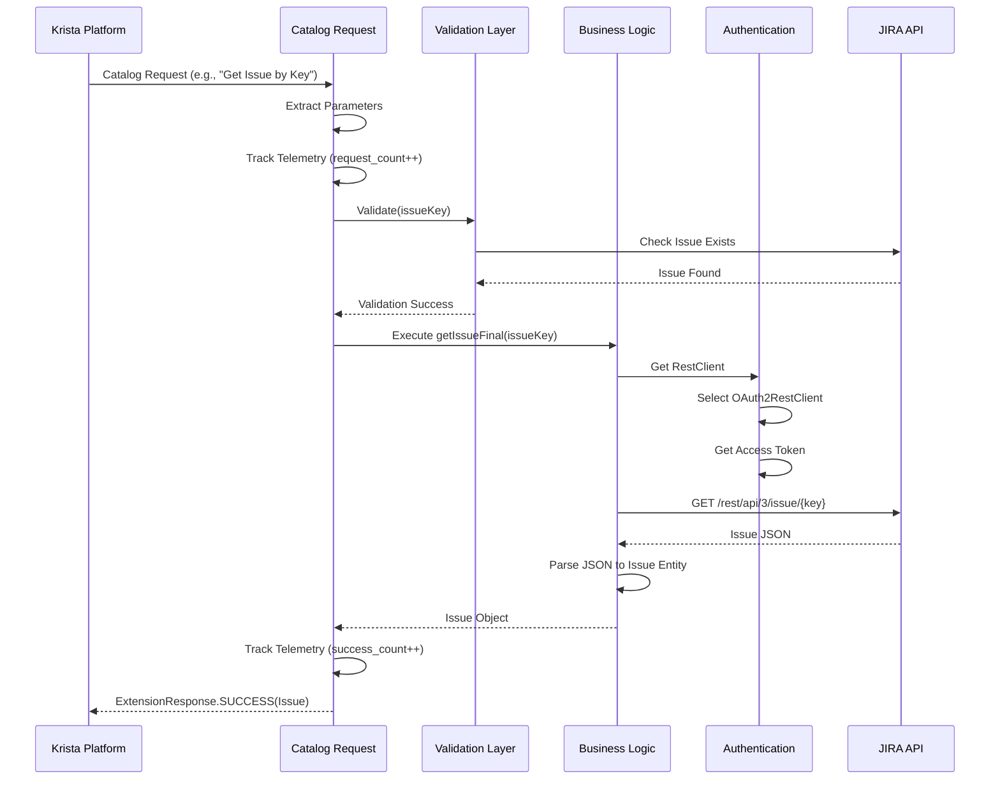
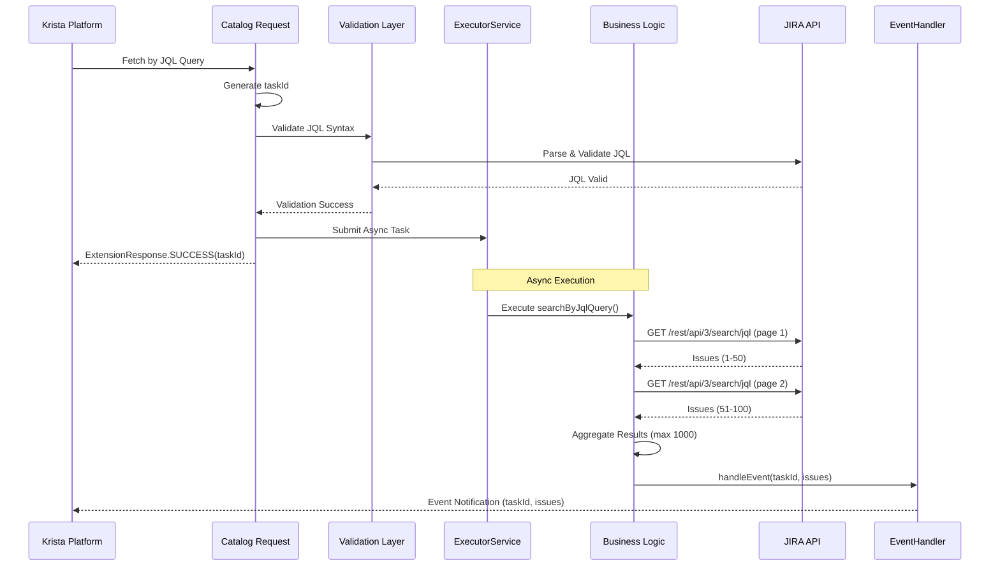
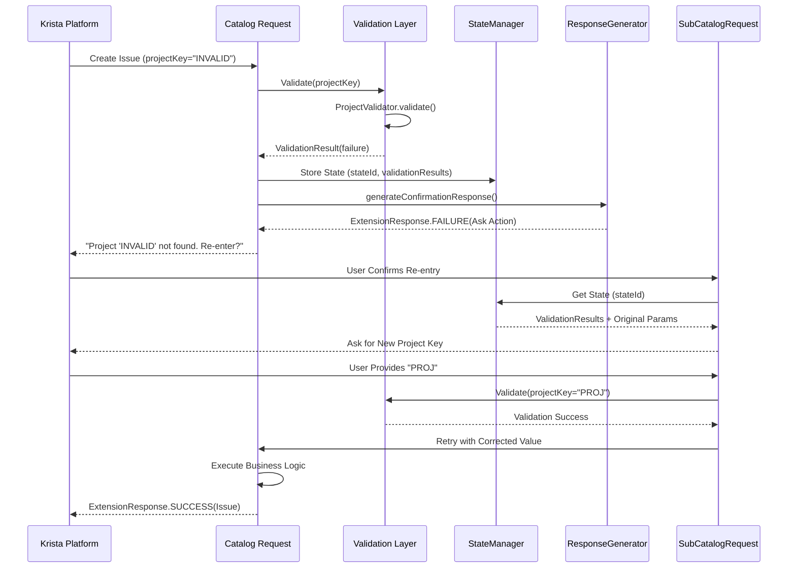
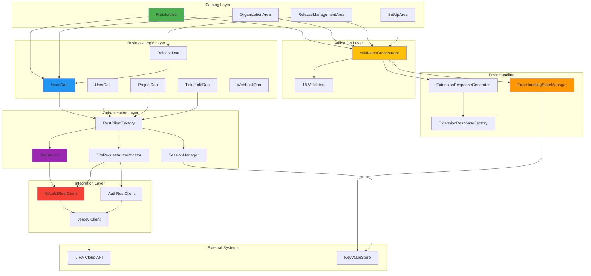

# JIRA Extension - Architecture Documentation

**Version:** 2.0.22  
**Last Updated:** 2026-01-16  
**Java Version:** 21  
**JIRA API:** REST API v3

---

## Table of Contents

1. [Executive Summary](#executive-summary)
2. [High-Level Architecture](#high-level-architecture)
3. [Layer-by-Layer Architecture](#layer-by-layer-architecture)
4. [Authentication Architecture](#authentication-architecture)
5. [Error Handling & Retry Architecture](#error-handling--retry-architecture)
6. [Data Flow Architecture](#data-flow-architecture)
7. [Performance Characteristics](#performance-characteristics)
8. [Error Scenarios & Mitigation](#error-scenarios--mitigation)
9. [Scalability & Limitations](#scalability--limitations)
10. [Technology Stack](#technology-stack)

---

## Executive Summary

The JIRA Extension is a production-grade integration built on a **5-layer architecture** that provides comprehensive JIRA project management capabilities through the Krista platform. The extension supports **29 catalog requests** across **4 functional areas** (Rituals, Organization, Release Management, SetUp) with robust error handling, validation, and retry mechanisms.

### Key Architectural Principles

- **Separation of Concerns**: Clear separation between catalog requests, validation, business logic, authentication, and integration layers
- **Dependency Injection**: HK2-based DI for loose coupling and testability
- **Fail-Safe Design**: Comprehensive validation and error handling with user-friendly retry flows
- **Dual Authentication**: Supports both OAuth 2.0 (production) and API Token (testing/single-user)
- **Async Processing**: ExecutorService-based async execution for long-running JQL queries
- **Telemetry-Driven**: Comprehensive metrics tracking for monitoring and optimization

---

## High-Level Architecture



### Architecture Layers Overview

| Layer | Responsibility | Key Components | Error Handling |
|-------|---------------|----------------|----------------|
| **1. Catalog Request** | Entry point for all requests | RitualsArea, OrganizationArea, ReleaseManagementArea, SetUpArea | Input validation, telemetry tracking |
| **2. Validation** | Input validation & verification | ValidationOrchestrator, 18 specialized validators | Retry flow with user confirmation |
| **3. Business Logic** | Core business operations | IssueDao, UserDao, ProjectDao, ReleaseDao, TicketInfoDao | Exception handling, state management |
| **4. Authentication** | OAuth 2.0 & API Token auth | JiraService, JiraRequestAuthenticator, RestClientFactory | MustAuthorizeException, token refresh |
| **5. Integration** | JIRA API communication | OAuth2RestClient, AuthRestClient, Jersey Client | HTTP error handling, retry logic |

---

## Layer-by-Layer Architecture

### Layer 1: Catalog Request Layer

**Purpose**: Entry point for all catalog requests with @CatalogRequest annotations



**Key Responsibilities**:
- Receive and parse catalog requests from Krista platform
- Extract and validate input parameters using @Field annotations
- Track telemetry metrics (request count, success count, failure count, retry attempts)
- Delegate to validation layer
- Handle SubCatalogRequest flows for retry scenarios

**Components**:
- `RitualsArea.java` - Daily operations (15 requests)
- `OrganizationArea.java` - Administrative tasks (7 requests)
- `ReleaseManagementArea.java` - Release management (1 request)
- `SetUpArea.java` - Configuration & health checks (2 requests)

**Error Handling**:
- Catches all exceptions and wraps in ExtensionResponse
- Increments failure telemetry counters
- Delegates to ExtensionResponseGenerator for user-friendly error messages

---

### Layer 2: Validation Layer

**Purpose**: Validate all inputs against JIRA system state before execution



**Key Responsibilities**:
- Validate inputs against JIRA system state (not just syntax)
- Check existence of projects, issues, users, statuses, priorities, etc.
- Extract field types and attributes from source method annotations
- Generate validation results with field metadata for retry flows
- Coordinate 18 specialized validators

**Validation Flow**:
1. **Input Reception**: Receive validation resources map from catalog request
2. **Validator Selection**: Select appropriate validators based on resource types
3. **Validation Execution**: Execute validators against JIRA API
4. **Result Aggregation**: Collect all validation failures
5. **Field Metadata Extraction**: Extract field types/attributes for retry UI
6. **Result Return**: Return ValidationResult list (empty = success)

**Error Handling**:
- Validation failures trigger retry flow (not hard errors)
- State stored in ErrorHandlingStateManager with unique stateId
- ExtensionResponseGenerator creates user-friendly confirmation prompts
- SubCatalogRequest handles user re-entry with corrected values

---

### Layer 3: Business Logic Layer (DAO Layer)

**Purpose**: Execute core business operations and interact with JIRA API



**Key Components**:

#### IssueDao
- **Methods**: createIssue, updateIssue, deleteIssue, getIssueFinal, searchByJQL, searchByJqlQuery, updateStatus, updateAssignee, updatePriority, addComment, attachFileToTicket, assignIssueToEpic
- **JIRA Endpoints**: `/issue`, `/issue/{key}`, `/issue/{key}/transitions`, `/issue/{key}/comment`, `/issue/{key}/attachments`, `/search/jql`
- **Performance**: Pagination support (default 20, max 1000), async JQL execution

#### UserDao
- **Methods**: searchUser, getUserByAccountId, getUsersByQuery, isUserExist
- **JIRA Endpoints**: `/user/search`, `/user`
- **Performance**: Pagination (default 50), recursive fetching for large result sets

#### ProjectDao
- **Methods**: getProjectByIdResponse, getIssueTypeFromProject, isProjectExists
- **JIRA Endpoints**: `/project/{key}`, `/project/search`
- **Performance**: Cached project metadata

#### ReleaseDao
- **Methods**: getGetReleaseSummaryResponse
- **JIRA Endpoints**: Uses IssueDao for JQL queries
- **Performance**: Aggregates multiple JQL queries (Stories, Tasks, Bugs, Epics)

#### TicketInfoDao
- **Methods**: getPriorities, getStatuses, getTransitions, getIssueTypes
- **JIRA Endpoints**: `/priority`, `/status`, `/issue/{key}/transitions`, `/issuetype`
- **Performance**: Metadata caching recommended

**Error Handling**:
- RuntimeException for JIRA API errors
- IllegalStateException for invalid state transitions
- NoSuchElementException for missing resources
- MustAuthorizeException for authentication failures

---

### Layer 4: Authentication Layer

**Purpose**: Handle OAuth 2.0 and API Token authentication



**Authentication Flow**:

#### OAuth 2.0 Flow (Client Credentials Grant)
1. **Authorization Request**: User initiates request → MustAuthorizeException thrown
2. **Redirect to JIRA**: JiraRequestAuthenticator generates authorization URL
3. **User Consent**: User authorizes in JIRA OAuth consent screen
4. **Callback**: JIRA redirects to `/callback` with authorization code
5. **Token Exchange**: JiraService exchanges code for access + refresh tokens
6. **Token Storage**: SessionManager stores refresh token with key `accountId#invokerId`
7. **API Requests**: OAuth2RestClient adds Bearer token to all requests
8. **Token Refresh**: Automatic refresh using refresh token when access token expires

#### API Token Flow (Basic Auth)
1. **Configuration**: Admin provides username + API token in extension attributes
2. **Client Creation**: AuthRestClient created with HttpAuthenticationFeature
3. **API Requests**: Basic Auth header added to all requests
4. **Limitation**: Cannot invoke as user (invokeAsUser=false only)

**Key Components**:
- `JiraRequestAuthenticator` - Implements RequestAuthenticator interface
- `JiraService` - OAuth service wrapper using ScribeJava
- `SessionManager` - Token storage using KeyValueStore
- `RestClientFactory` - Factory pattern for client selection
- `OAuth2RestClient` - OAuth 2.0 REST client implementation
- `AuthRestClient` - Basic Auth REST client implementation

**Error Handling**:
- `MustAuthorizeException` - Triggers OAuth flow
- `IllegalCallerException` - Missing OAuth credentials
- `ExecutionException` - Token exchange/refresh failures
- Automatic retry with token refresh on 401 responses

---

### Layer 5: Integration Layer

**Purpose**: Low-level HTTP communication with JIRA REST API v3

```mermaid
graph TB
    subgraph "Integration Layer"
        A[RestClient Interface]
        B[OAuth2RestClient]
        C[AuthRestClient]
    end

    subgraph "HTTP Clients"
        D[Jersey Client<br/>JAX-RS 2.0]
        E[Unirest<br/>File Upload]
    end

    subgraph "JIRA API Endpoints"
        F[/rest/api/3/issue]
        G[/rest/api/3/search/jql]
        H[/rest/api/3/user]
        I[/rest/api/3/project]
        J[/rest/api/3/priority]
        K[/rest/api/3/status]
        L[/rest/api/3/issuetype]
    end

    A --> B
    A --> C

    B --> D
    C --> D
    B --> E

    D --> F
    D --> G
    D --> H
    D --> I
    D --> J
    D --> K
    D --> L

    E --> M[/rest/api/3/issue/{key}/attachments]

    style B fill:#4CAF50
    style C fill:#2196F3
    style D fill:#FF9800
    style E fill:#9C27B0
```

**Key Responsibilities**:
- Construct HTTP requests with proper headers and authentication
- Handle HTTP responses and error codes
- Manage connection pooling and timeouts
- Parse JSON responses using GSON
- Handle file uploads with multipart/form-data

**RestClient Interface Methods**:
- `getResourceInvoker(resource, queryParams)` - Create JAX-RS Invocation.Builder
- `fetch(resource, queryParams, type)` - Execute GET request
- `fetchIssues(invokeAsUser, accountId, invokerId, resource, queryParams, type)` - Fetch issues with user context
- `parseAndValidateJQL(jql, invokeAsUser, accountId, invokerId)` - Validate JQL syntax
- `attachFile(resource, files)` - Upload files to JIRA
- `getJiraAccessToken()` - Get current access token

**HTTP Error Handling**:
- **400 Bad Request**: Invalid input, validation error
- **401 Unauthorized**: Token expired, trigger refresh or re-auth
- **403 Forbidden**: Insufficient permissions
- **404 Not Found**: Resource doesn't exist
- **429 Too Many Requests**: Rate limit exceeded, exponential backoff
- **500 Internal Server Error**: JIRA server error, retry with backoff

---

## Error Handling & Retry Architecture



### Error Handling Components

#### ErrorHandlingStateManager
- **Purpose**: Manage state for retry flows
- **Storage**: KeyValueStore (distributed, persistent)
- **Key Format**: UUID (stateId)
- **Value Format**: JSON with validation results + original parameters
- **Methods**: `put(stateId, state)`, `get(stateId)`

#### ExtensionResponseGenerator
- **Purpose**: Generate user-friendly error responses with remediation actions
- **Methods**:
  - `generateConfirmationResponse()` - Ask user to confirm re-entry
  - `generateFetchResponse()` - Ask user to provide corrected values
  - `generateFetchDenyResponse()` - Inform user of denial
- **Output**: ExtensionResponse with RemediationActions (Ask, Inform)

#### ExtensionResponseFactory
- **Purpose**: Factory for creating ExtensionResponse objects
- **Methods**:
  - `create(data)` - Success response
  - `create(exception, message, type)` - Error response
  - `create(message, type, actions, subCatalogRequest, state)` - Retry response
- **Error Types**: INPUT_ERROR, SYSTEM_ERROR, LOGIC_ERROR

### Retry Flow Example

**Scenario**: User provides invalid issue key "PROJ-999" (doesn't exist)

1. **Validation**: IssueValidator checks if issue exists → Failure
2. **State Storage**: ErrorHandlingStateManager stores state with stateId="abc-123"
3. **Confirmation**: ExtensionResponseGenerator creates confirmation response:
   - Message: "Issue 'PROJ-999' does not exist in JIRA"
   - Action: Ask "Would you like to re-enter the issue key?"
   - Field: Switch field "re-enter"
4. **User Choice**: User selects "Yes"
5. **Fetch**: SubCatalogRequest asks for new issue key
6. **Re-validation**: User provides "PROJ-100" → Validation success
7. **Execution**: Business logic executes with corrected value

---

## Data Flow Architecture

### Synchronous Request Flow



### Asynchronous Request Flow (JQL Query)



### Validation Retry Flow



---

## Performance Characteristics

### Pagination & Limits

| Operation | Default Page Size | Max Page Size | Max Total Results | Pagination Type |
|-----------|------------------|---------------|-------------------|-----------------|
| Search by JQL | 50 | 100 | 1000 | Cursor-based (nextPageToken) |
| Get Issues | 20 | 100 | 1000 | Offset-based (startAt) |
| Search Users | 50 | 100 | Unlimited | Recursive fetching |
| Get Projects | N/A | N/A | All | Single request |
| Get Priorities | N/A | N/A | All | Single request |
| Get Statuses | N/A | N/A | All | Single request |

### Async Execution

**ExecutorService Configuration**:
- **Type**: Single-threaded executor (`Executors.newSingleThreadExecutor()`)
- **Usage**: JQL query execution (long-running operations)
- **Thread Locals**: Preserved using `ThreadLocalProxy.getAll()` and `ThreadLocalProxy.setAll()`
- **Event Notification**: Results delivered via `EventHandler.handleEvent(taskId, data)`

**Async Operations**:
1. **Fetch by JQL Query** - Can return 1000+ issues, executed asynchronously
2. **Bulk Operations** - Future enhancement for batch updates

### Caching Strategy

**Current State**: No explicit caching implemented

**Recommended Caching**:
- **Project Metadata**: Cache for 5 minutes (rarely changes)
- **User Data**: Cache for 5 minutes (frequently accessed)
- **Priorities/Statuses**: Cache for 1 hour (static data)
- **Issue Types**: Cache for 1 hour (static data)
- **Cache Implementation**: Use KeyValueStore with TTL

### Rate Limiting

**JIRA Cloud Rate Limits**:
- **Standard**: 100 requests per minute per user
- **Burst**: 10 concurrent requests
- **Retry Strategy**: Exponential backoff on 429 responses

**Extension Rate Limiting**:
- **Current**: No explicit rate limiting
- **Recommended**: Implement token bucket algorithm
- **Configuration**: 100 requests/minute, 10 concurrent

### Timeout Configuration

**Current Timeouts**:
- **HTTP Read Timeout**: Default Jersey Client timeout (60 seconds)
- **HTTP Connect Timeout**: Default Jersey Client timeout (10 seconds)
- **JQL Query Timeout**: No explicit timeout (async execution)

**Recommended Timeouts**:
- **Synchronous Operations**: 30 seconds
- **Asynchronous Operations**: 5 minutes
- **File Upload**: 2 minutes

### Connection Pooling

**Current State**: Jersey Client default connection pooling

**Recommended Configuration**:
- **Max Connections**: 20
- **Max Connections Per Route**: 10
- **Connection Timeout**: 10 seconds
- **Socket Timeout**: 60 seconds
- **Keep-Alive**: 30 seconds

---

## Error Scenarios & Mitigation

### Error Scenario Matrix

| Error Scenario | Layer | Error Type | Mitigation Strategy | User Impact |
|----------------|-------|------------|---------------------|-------------|
| **Invalid Issue Key** | Validation | INPUT_ERROR | Retry flow with validation | User re-enters correct key |
| **Project Not Found** | Validation | INPUT_ERROR | Retry flow with project list | User selects valid project |
| **User Not Found** | Validation | INPUT_ERROR | Retry flow with user search | User provides valid user ID |
| **Invalid JQL Syntax** | Validation | INPUT_ERROR | Retry flow with JQL help | User corrects JQL query |
| **Invalid Status Transition** | Business Logic | LOGIC_ERROR | Show available transitions | User selects valid transition |
| **OAuth Token Expired** | Authentication | SYSTEM_ERROR | Automatic token refresh | Transparent to user |
| **OAuth Authorization Failed** | Authentication | SYSTEM_ERROR | Re-authorization flow | User re-authorizes |
| **JIRA API Unavailable** | Integration | SYSTEM_ERROR | Retry with exponential backoff | Temporary delay |
| **Rate Limit Exceeded** | Integration | SYSTEM_ERROR | Exponential backoff | Temporary delay |
| **Network Timeout** | Integration | SYSTEM_ERROR | Retry with timeout increase | Temporary delay |
| **File Upload Failed** | Integration | SYSTEM_ERROR | Retry with smaller chunks | User retries upload |
| **Insufficient Permissions** | Integration | LOGIC_ERROR | Inform user, suggest admin | User contacts admin |
| **Invalid Field Value** | Business Logic | INPUT_ERROR | Retry flow with field validation | User provides valid value |
| **Concurrent Modification** | Business Logic | LOGIC_ERROR | Retry with latest version | Automatic retry |
| **Attachment Too Large** | Business Logic | INPUT_ERROR | Inform user of size limit | User reduces file size |

### Error Handling Patterns

#### Pattern 1: Validation Error with Retry

```java
// Validation fails
List<ValidationResult> validationResults = validationOrchestrator.validate(
    Map.of(ValidationResource.TICKET_ID, issueKey)
);

if (!validationResults.isEmpty()) {
    // Generate unique state ID
    String stateId = UUID.randomUUID().toString();

    // Store state for retry
    internalStateManager.put(stateId, Map.of(
        "Validation Results", validationResults,
        "Original Parameters", Map.of("Issue Key", issueKey)
    ));

    // Generate confirmation response
    return responseGenerator.generateConfirmationResponse(
        ExtensionResponse.Error.ExceptionType.INPUT_ERROR,
        validationResults,
        "confirmReenterIssueKey",
        Map.of("stateId", stateId, "Issue Key", issueKey)
    );
}
```

#### Pattern 2: OAuth Token Refresh

```java
public OAuth2AccessToken getJiraAccessToken(String accountId, String invokerId) {
    try {
        String refreshToken = sessionManager.getRefToken(accountId + "#" + invokerId);
        if (refreshToken == null) {
            throw new MustAuthorizeException("Authorization required");
        }

        // Refresh access token
        OAuth2AccessToken oAuth2AccessToken = getOauthService().refreshAccessToken(refreshToken);

        // Store new refresh token
        sessionManager.storeRefToken(accountId + "#" + invokerId,
            oAuth2AccessToken.getRefreshToken());

        return oAuth2AccessToken;
    } catch (ExecutionException cause) {
        // Token refresh failed, trigger re-authorization
        throw new MustAuthorizeException("Re-authorization required");
    }
}
```

#### Pattern 3: JIRA API Error Handling

```java
Response response = invoker.post(Entity.entity(body, MediaType.APPLICATION_JSON));

if (response.getStatus() >= 400) {
    String errorMessage = response.readEntity(String.class);

    switch (response.getStatus()) {
        case 400:
            throw new IllegalArgumentException("Invalid input: " + errorMessage);
        case 401:
            throw new MustAuthorizeException("Authentication required");
        case 403:
            throw new IllegalCallerException("Insufficient permissions: " + errorMessage);
        case 404:
            throw new NoSuchElementException("Resource not found: " + errorMessage);
        case 429:
            // Rate limit exceeded - exponential backoff
            Thread.sleep(calculateBackoff(retryCount));
            return retry(retryCount + 1);
        default:
            throw new RuntimeException("JIRA API error: " + errorMessage);
    }
}
```

#### Pattern 4: Async Error Handling

```java
executorService.submit(() -> {
    ThreadLocalProxy.setAll(threadLocals);
    FreeForm freeForm = new FreeForm();

    try {
        List<Issue> issues = issueDao.searchByJqlQuery(
            invokeAsUser, accountID, invokerId, jQLQuery, pageSize
        );

        freeForm.put("IsError", "Switch", false);
        freeForm.put("Data", "[ Entity(Issue) ]", issues);
    } catch (Exception cause) {
        freeForm.put("IsError", "Switch", true);
        freeForm.put("ErrorMessage", "Text",
            "Error occurred while fetching JQL - " + cause.getMessage());
    }

    eventHandler.handleEvent(taskId, freeForm);
});
```

### Telemetry & Monitoring

**Telemetry Metrics** (tracked per catalog request):
- `request_count` - Total requests received
- `success_count` - Successful executions
- `failure_count` - Failed executions
- `retry_attempt_count` - Retry flow initiations

**Example Telemetry Constants**:
```java
// RitualsArea telemetry
public static final String GET_ISSUE_BY_KEY_REQUEST_COUNT = "jira.rituals.get_issue_by_key.request_count";
public static final String GET_ISSUE_BY_KEY_REQUEST_SUCCESS = "jira.rituals.get_issue_by_key.success_count";
public static final String GET_ISSUE_BY_KEY_REQUEST_FAILURE = "jira.rituals.get_issue_by_key.failure_count";
public static final String GET_ISSUE_BY_KEY_RETRY_ATTEMPT = "jira.rituals.get_issue_by_key.retry_attempt_count";
```

**Monitoring Recommendations**:
- Track success/failure rates per catalog request
- Monitor retry attempt rates (high rates indicate UX issues)
- Track OAuth token refresh rates
- Monitor JIRA API response times
- Alert on high failure rates (>5%)
- Alert on rate limit errors

---

## Scalability & Limitations

### Current Limitations

#### Performance Limitations

| Limitation | Current Value | Impact | Mitigation |
|------------|---------------|--------|------------|
| **Max Issues per JQL Query** | 1000 | Large result sets truncated | Use pagination, filter queries |
| **Single-threaded Async Executor** | 1 thread | Sequential async processing | Upgrade to thread pool |
| **No Connection Pooling Config** | Default (unlimited) | Potential resource exhaustion | Configure max connections |
| **No Request Rate Limiting** | Unlimited | Risk of JIRA rate limit errors | Implement token bucket |
| **No Response Caching** | None | Repeated API calls for static data | Implement caching layer |
| **Synchronous Validation** | Blocking | Slow validation for multiple resources | Parallel validation |
| **No Batch Operations** | Single operations only | Inefficient for bulk updates | Implement batch APIs |

#### Functional Limitations

| Limitation | Impact | Workaround |
|------------|--------|------------|
| **No Custom Field Support** | Cannot update custom fields | Use FreeForm fields (limited) |
| **No Advanced JQL Features** | Limited query capabilities | Use JIRA UI for complex queries |
| **No Webhook Filtering** | All events received | Filter in ListenerResource |
| **No Multi-Project Operations** | One project at a time | Loop through projects |
| **No Issue Linking** | Cannot create issue links | Use JIRA UI |
| **No Sprint Management** | No sprint operations | Use JIRA UI |
| **No Board Operations** | No Kanban/Scrum board access | Use JIRA UI |

### Scalability Considerations

#### Horizontal Scalability

**Current State**: Stateless design supports horizontal scaling

**Considerations**:
- **Session Storage**: Uses KeyValueStore (distributed)
- **State Management**: Uses KeyValueStore (distributed)
- **No Local Caching**: All state is external
- **Thread Safety**: HK2 dependency injection handles concurrency

**Scaling Strategy**:
1. Deploy multiple extension instances
2. Use load balancer for distribution
3. Ensure KeyValueStore is distributed (Redis, etc.)
4. Monitor per-instance metrics

#### Vertical Scalability

**Resource Requirements**:
- **CPU**: Low (mostly I/O bound)
- **Memory**: Medium (JSON parsing, entity objects)
- **Network**: High (REST API calls)
- **Disk**: Low (no local storage)

**Scaling Strategy**:
1. Increase heap size for large result sets
2. Tune JVM garbage collection
3. Optimize JSON parsing (streaming)
4. Implement connection pooling

#### Data Volume Scalability

**Current Limits**:
- **Issues per Query**: 1000 (hard limit)
- **Users per Search**: Unlimited (recursive fetching)
- **Projects**: All (single request)
- **Attachments**: JIRA API limits (10MB per file)

**Scaling Strategy**:
1. Implement cursor-based pagination for all operations
2. Add streaming JSON parsing for large responses
3. Implement result set chunking
4. Add progress tracking for long operations

### Performance Optimization Recommendations

#### Short-term (Quick Wins)

1. **Implement Response Caching**
   - Cache priorities, statuses, issue types (1 hour TTL)
   - Cache project metadata (5 minutes TTL)
   - Cache user data (5 minutes TTL)
   - **Expected Impact**: 30-50% reduction in API calls

2. **Configure Connection Pooling**
   - Set max connections to 20
   - Set max connections per route to 10
   - **Expected Impact**: 20% improvement in response time

3. **Implement Request Rate Limiting**
   - Token bucket: 100 requests/minute
   - Burst: 10 concurrent requests
   - **Expected Impact**: Prevent JIRA rate limit errors

4. **Parallel Validation**
   - Validate multiple resources in parallel
   - Use CompletableFuture for async validation
   - **Expected Impact**: 40% reduction in validation time

#### Medium-term (Architectural Improvements)

1. **Upgrade Async Executor**
   - Replace single-threaded executor with thread pool
   - Configure pool size based on load
   - **Expected Impact**: Support concurrent async operations

2. **Implement Batch Operations**
   - Batch issue updates (up to 50 issues)
   - Batch user operations
   - **Expected Impact**: 80% reduction in API calls for bulk operations

3. **Add Custom Field Support**
   - Parse custom field metadata
   - Support custom field updates
   - **Expected Impact**: Unlock advanced JIRA features

4. **Implement Webhook Filtering**
   - Filter events by project, issue type, etc.
   - Reduce unnecessary processing
   - **Expected Impact**: 60% reduction in webhook processing

#### Long-term (Strategic Enhancements)

1. **GraphQL API Support**
   - Migrate to JIRA GraphQL API (when available)
   - Reduce over-fetching
   - **Expected Impact**: 50% reduction in data transfer

2. **Event-Driven Architecture**
   - Use webhooks for real-time updates
   - Reduce polling operations
   - **Expected Impact**: Near real-time data synchronization

3. **Intelligent Caching**
   - Implement cache invalidation via webhooks
   - Use predictive pre-fetching
   - **Expected Impact**: 70% reduction in API calls

4. **Advanced Analytics**
   - Track query patterns
   - Optimize frequently used queries
   - **Expected Impact**: Continuous performance improvement

---

## Technology Stack

### Core Technologies

| Technology | Version | Purpose | License |
|------------|---------|---------|---------|
| **Java** | 21 | Runtime platform | Oracle Binary Code License |
| **Gradle** | 8.5 | Build automation | Apache 2.0 |
| **HK2** | 3.0.3 | Dependency injection | EPL 2.0 / GPL 2.0 |
| **Jersey** | 2.35 | JAX-RS REST client | EPL 2.0 / GPL 2.0 |
| **GSON** | 2.10.1 | JSON parsing | Apache 2.0 |
| **ScribeJava** | 8.3.3 | OAuth 2.0 library | MIT |
| **Unirest** | 1.4.9 | HTTP client (file upload) | MIT |
| **SLF4J** | 2.0.9 | Logging facade | MIT |

### Krista Platform Dependencies

| Dependency | Version | Purpose |
|------------|---------|---------|
| **krista-apis** | 1.0.118 | Krista SDK APIs |
| **extension-impl-anno-processors** | 1.0.118 | Annotation processors |

### JIRA API

| API | Version | Endpoint | Documentation |
|-----|---------|----------|---------------|
| **JIRA REST API** | v3 | `https://api.atlassian.com/ex/jira/{cloudId}/rest/api/3/` | [Atlassian Docs](https://developer.atlassian.com/cloud/jira/platform/rest/v3/) |
| **OAuth 2.0 (3LO)** | 2.0 | `https://auth.atlassian.com/authorize` | [Atlassian OAuth](https://developer.atlassian.com/cloud/jira/platform/oauth-2-3lo-apps/) |

### Architecture Patterns

| Pattern | Implementation | Purpose |
|---------|----------------|---------|
| **Layered Architecture** | 5 layers (Catalog, Validation, Business Logic, Auth, Integration) | Separation of concerns |
| **Factory Pattern** | RestClientFactory, ExtensionResponseFactory | Object creation abstraction |
| **Strategy Pattern** | Validator implementations | Pluggable validation strategies |
| **Registry Pattern** | ServiceRegistry | Entity service lookup |
| **Builder Pattern** | JQLBuilder | Fluent JQL query construction |
| **Dependency Injection** | HK2 @Inject, @Service | Loose coupling, testability |
| **Async Processing** | ExecutorService | Non-blocking long operations |
| **State Management** | ErrorHandlingStateManager | Retry flow state persistence |

### Design Principles

| Principle | Implementation | Benefit |
|-----------|----------------|---------|
| **SOLID** | Single responsibility per class | Maintainability |
| **DRY** | Shared utilities, base classes | Code reuse |
| **KISS** | Simple, focused methods | Readability |
| **YAGNI** | Minimal feature set | Reduced complexity |
| **Fail-Safe** | Comprehensive error handling | Reliability |
| **Testability** | DI, interface-based design | Unit testing |

---

## Architecture Diagrams Summary

### Component Dependency Diagram



---

## Conclusion

The JIRA Extension implements a robust, production-ready architecture with clear separation of concerns across 5 layers. The design prioritizes:

1. **Reliability**: Comprehensive validation and error handling with user-friendly retry flows
2. **Security**: Dual authentication (OAuth 2.0 + API Token) with secure token management
3. **Performance**: Async processing, pagination, and optimization opportunities
4. **Maintainability**: Clean architecture, dependency injection, and SOLID principles
5. **Scalability**: Stateless design supporting horizontal scaling

### Key Strengths

- ✅ **Comprehensive Validation**: 18 specialized validators ensure data integrity
- ✅ **User-Friendly Error Handling**: Retry flows with state management
- ✅ **Dual Authentication**: Supports both OAuth 2.0 and API Token
- ✅ **Async Processing**: Non-blocking execution for long-running operations
- ✅ **Telemetry**: Comprehensive metrics for monitoring and optimization
- ✅ **Clean Architecture**: 5-layer design with clear responsibilities

### Areas for Improvement

- ⚠️ **Caching**: No response caching (30-50% API call reduction opportunity)
- ⚠️ **Connection Pooling**: Default configuration (20% performance improvement opportunity)
- ⚠️ **Rate Limiting**: No request rate limiting (risk of JIRA rate limit errors)
- ⚠️ **Batch Operations**: No batch update support (80% API call reduction opportunity)
- ⚠️ **Custom Fields**: Limited custom field support (functional limitation)
- ⚠️ **Thread Pool**: Single-threaded async executor (concurrency limitation)

### Recommended Next Steps

1. **Implement response caching** for static data (priorities, statuses, issue types)
2. **Configure connection pooling** for Jersey Client
3. **Add request rate limiting** to prevent JIRA API rate limit errors
4. **Upgrade async executor** to thread pool for concurrent operations
5. **Implement batch operations** for bulk updates
6. **Add custom field support** for advanced JIRA features

---

**Document Version**: 1.0
**Last Updated**: 2026-01-16
**Author**: JIRA Extension Architecture Team
**Contact**: architecture@krista.ai


