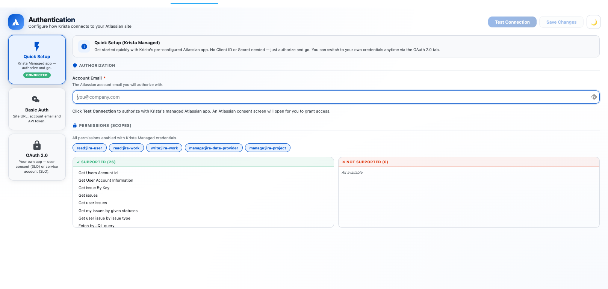
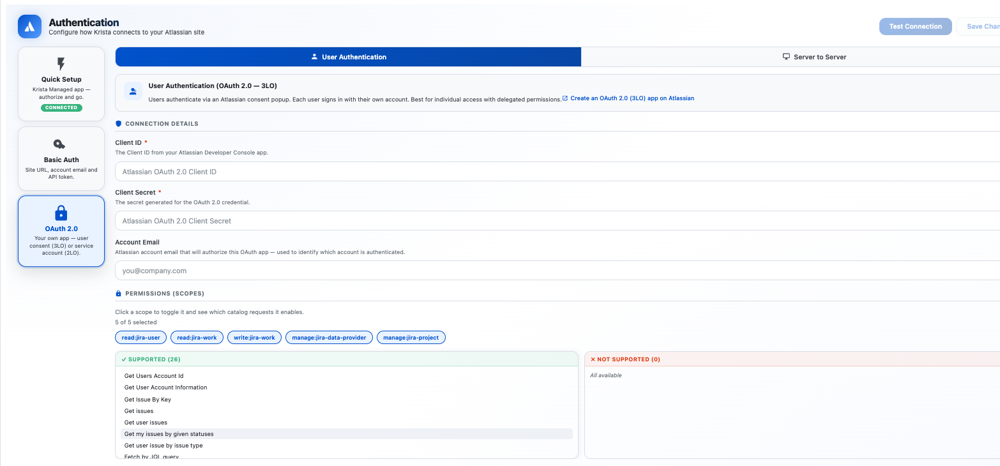
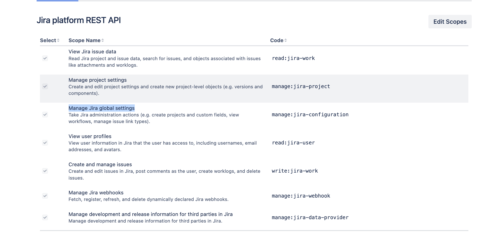
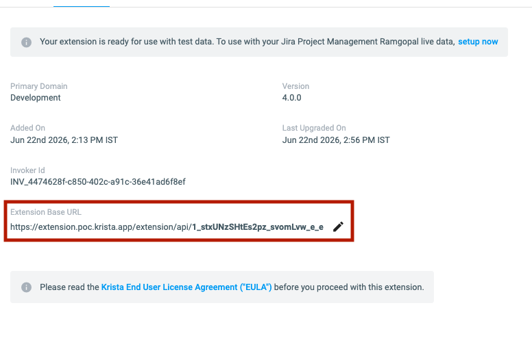
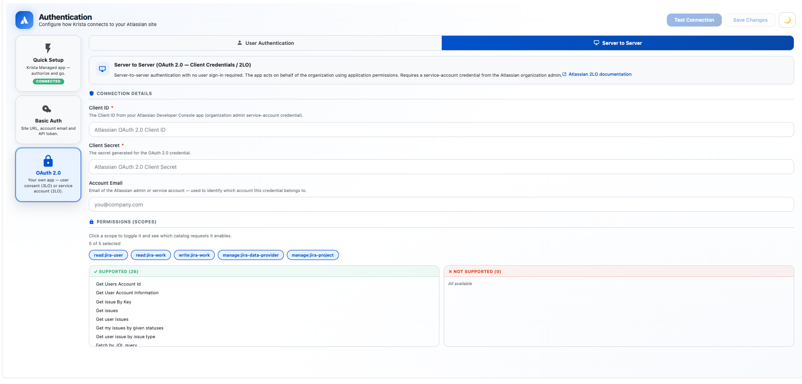
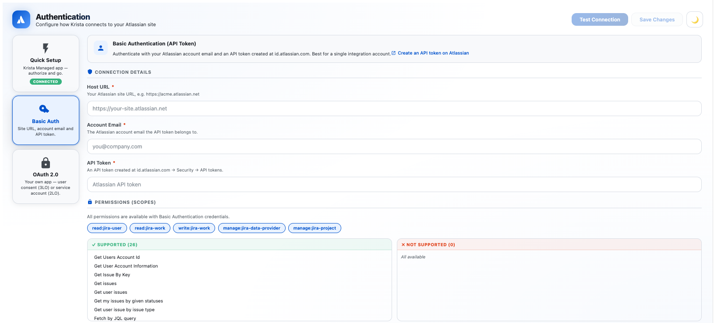

# Authentication

## Overview

The Jira Project Management Extension supports four authentication configurations, each suited for different needs:

| # | Configuration | Auth Flow | User Sign-In | Best For |
|---|--------------|-----------|--------------|----------|
| 1 | **Quick Setup** | Authorization Code (Delegated) | Yes | Quick setup, testing, small teams |
| 2 | **OAuth 2.0 — User Authentication** | Authorization Code (Delegated) | Yes | Enterprise control, custom permissions |
| 3 | **OAuth 2.0 — Server to Server** | Client Credentials (2LO) | No (service account) | Automated workflows, service accounts |
| 4 | **Basic Auth** | HTTP Basic | No (API token) | Simple automation, development |

## Authentication Tab

The **Authentication** tab in the extension provides a unified interface for all authentication types. It is organized with a left sidebar and a main panel:

- **Quick Setup** — OAuth 2.0 with Krista's pre-registered Atlassian app (managed credentials). Scopes are displayed as read-only chips.
- **Basic Auth** — Host URL, account email, and API token (HTTP Basic authentication).
- **OAuth 2.0** — Your own Atlassian Developer Console app with two sub-tabs:
  - **User Authentication** — Individual user signs in via browser popup (Authorization Code / 3LO flow).
  - **Server to Server** — App-only authentication with no user sign-in (Client Credentials / 2LO flow).

After selecting the type, enter the required fields, click **Test Connection**, and then **Save Changes**.

---

## Quick Setup

### What It Is

Uses Krista's pre-registered Atlassian OAuth 2.0 application for authentication. The user signs in via a browser popup and grants delegated permissions. No Atlassian Developer Console configuration is required.

### When to Use

- Getting started quickly with minimal setup
- Development and testing environments
- Organizations where creating an Atlassian OAuth app is not available
- Small teams that don't need custom permission policies

### Required Fields

| Field | Required | Description |
|-------|----------|-------------|
| Client ID | Auto-filled | Provided by Krista's pre-registered app |
| Client Secret | Auto-filled | Provided by Krista's pre-registered app |

### How It Works

1. Select the **Quick Setup** tab in the Authentication screen
2. Click **Test Connection** — a Jira sign-in popup opens
3. Sign in with your Atlassian account and grant the requested permissions
4. After the popup closes, the connection is verified automatically
5. Click **Save Changes** to persist the configuration



### Authentication Flow

```
User clicks Test Connection
  → Browser popup opens Atlassian login page
  → User signs in and grants consent to Krista's Atlassian OAuth app
  → Atlassian returns authorization code to callback URL
  → Extension exchanges code for access + refresh tokens
  → Tokens stored securely under the invoker ID
  → Subsequent API calls use stored tokens with automatic refresh
```

### Scopes

All scopes are fixed and displayed as **read-only chips** in the Quick Setup tab. They cannot be changed in Quick Setup mode:

| Scope | Purpose | Catalog Requests |
|-------|---------|------------------|
| `read:jira-user` | Read user profiles and account IDs | Get Users Account Id, Get User Account Information |
| `read:jira-work` | Read issues, comments, and work items | Get Issue By Key, Get issues, Get user issues, Get my issues by given statuses, Get user issue by issue type, Fetch by JQL query, Get Results for Fetch Issues by JQL Query, Get all comments, Get Custom Field Value |
| `write:jira-work` | Create and update issues | Create an issue, Report a bug, Update an issue, Update status of issue, Update status of multiple issues, Update priority of issue, Assign a task to user, Add a comment, Add worklog, Attach File to Ticket |
| `manage:jira-data-provider` | Manage webhooks and data providers | Get Notification |
| `manage:jira-project` | Manage projects, epics, and releases | Get release summary, Assign Issue to Epic, Assign Child Issue to Epic |
| `manage:jira-configuration` | Manage Jira global settings | Save Extension Configuration |
| `manage:jira-webhook` | Manage Jira webhooks | Get Notification |

### Limitations

- Cannot customize which scopes are requested
- Cannot apply organization-specific conditional access policies
- Krista's Atlassian app is shared across all Quick Setup users

---

## OAuth 2.0 — User Authentication

### What It Is

Uses your own Atlassian OAuth 2.0 application for delegated (3LO) authentication. Each user signs in via a browser popup through your own Atlassian Developer Console app. This provides full control over permissions, scopes, and audit logging.

### When to Use

- Production environments requiring enterprise-grade security
- Organizations that need to restrict the OAuth app to their Atlassian instance
- When you need full audit trails through Atlassian's admin logs
- When you need to customize exactly which scopes are requested
- Per-user authentication (each user authenticates with their own account)

### Prerequisites

- A registered Atlassian OAuth 2.0 app (see [Getting OAuth 2.0 Credentials](pages/GettingOAuth2Credentials.md))
- Application (Client) ID and Client Secret
- Required scopes granted in the Atlassian Developer Console
- Callback URL configured in your Atlassian app (see [Callback URL](#callback-url) below)

### Required Fields

| Field | Required | Description |
|-------|----------|-------------|
| Client ID | Yes | OAuth app Client ID from Atlassian Developer Console |
| Client Secret | Yes | OAuth app Client Secret |
| Account Email | Optional | Atlassian account email that will authorize this OAuth app |

### How It Works

1. Select the **OAuth 2.0** tab → **User Authentication** sub-tab in the Authentication screen
2. Enter your Client ID and Client Secret
3. Toggle the scopes you want to request in the **Permissions (Scopes)** panel
4. Click **Test Connection** — a Jira sign-in popup opens
5. Sign in with your Atlassian account and grant consent to your app
6. After the popup closes, the connection is verified
7. Click **Save Changes** to persist the configuration



### Authentication Flow

```
User clicks Test Connection
  → Browser popup opens: https://auth.atlassian.com/authorize
  → User authenticates against Atlassian
  → User grants consent to your OAuth app
  → Atlassian returns authorization code to callback URL
  → Extension exchanges code + client_secret for access + refresh tokens
  → Tokens stored securely under the invoker ID
```

### Scope Configuration

When using User Authentication, you can toggle individual scopes in the **Permissions (Scopes)** panel. Only select scopes that match the permissions granted in your Atlassian app.

In the Atlassian Developer Console, go to **Permissions** → **Jira platform REST API** → **Edit Scopes** and enable the following:



| Scope | Catalog Requests Enabled |
|-------|--------------------------|
| `read:jira-user` | Get Users Account Id, Get User Account Information |
| `read:jira-work` | Get Issue By Key, Get issues, Get user issues, Get my issues by given statuses, Get user issue by issue type, Fetch by JQL query, Get Results for Fetch Issues by JQL Query, Get all comments, Get Custom Field Value |
| `write:jira-work` | Create an issue, Report a bug, Update an issue, Update status of issue, Update status of multiple issues, Update priority of issue, Assign a task to user, Add a comment, Add worklog, Attach File to Ticket |
| `manage:jira-data-provider` | Manage webhooks and data providers |
| `manage:jira-project` | Get release summary, Assign Issue to Epic, Assign Child Issue to Epic |
| `manage:jira-configuration` | Save Extension Configuration |
| `manage:jira-webhook` | Get Notification |

> **Important**: Ensure all selected scopes are granted in your Atlassian Developer Console. Missing scopes will cause specific catalog requests to fail.

### Callback URL

The callback URL is based on your **Extension Base URL**, which is unique to each installed extension. You can find it on the extension's details page in Krista:



**Format:**
```
{Extension Base URL}/jiraextn/callback
```

**Example:**
```
https://extension.poc.krista.app/extension/api/1_stxUNzSHtEs2pz_svomLvw_e_e/jiraextn/callback
```

Copy your **Extension Base URL** from the Krista extension details page, append `/jiraextn/callback`, and register that full URL as the Callback URL in your Atlassian Developer Console under the **Authorization** tab.

---

## OAuth 2.0 — Server to Server

### What It Is

Uses your own Atlassian OAuth 2.0 application for app-only (2LO) authentication. No user sign-in is required — the app acts on behalf of the organization using application permissions. Requires a service-account credential from the Atlassian organization admin.

### When to Use

- Fully automated workflows where no user browser popup is feasible
- Service-account based integrations
- Workflows that should run as the organization/admin account, not a specific user
- CI/CD pipelines and background automation

### Prerequisites

- A registered Atlassian OAuth 2.0 app with 2LO (service account) enabled (see [Atlassian 2LO documentation](https://developer.atlassian.com/cloud/jira/platform/oauth-2-3lo-apps/))
- Application (Client) ID and Client Secret from an organization admin service-account credential
- Account Email of the Atlassian admin or service account

### Required Fields

| Field | Required | Description |
|-------|----------|-------------|
| Client ID | Yes | OAuth app Client ID (organization admin service-account credential) |
| Client Secret | Yes | OAuth app Client Secret |
| Account Email | Yes | Email of the Atlassian admin or service account |

### How It Works

1. Select the **OAuth 2.0** tab → **Server to Server** sub-tab in the Authentication screen
2. Enter your Client ID, Client Secret, and Account Email
3. Click **Test Connection** — the extension authenticates directly (no popup)
4. Click **Save Changes** to persist the configuration



### Authentication Flow

```
Extension calls Atlassian token endpoint with client_credentials grant
  → Atlassian issues access token for the app (no user consent)
  → Extension uses access token for all API calls on behalf of the service account
  → Token auto-refreshed on expiry
```

### Callback URL

The Server to Server flow does not use a callback URL — it uses direct token exchange, so no callback URL is required in the Atlassian Developer Console for 2LO.

---

## Basic Auth

### What It Is

Uses an Atlassian API token combined with your account email and Jira host URL for HTTP Basic authentication. No browser popup or OAuth flow is required.

### When to Use

- Fully automated workflows where no browser popup is feasible
- Development and testing environments
- Read-only automation tasks
- Environments where OAuth is not supported

### Prerequisites

- A Jira user account with appropriate permissions
- An Atlassian API token (see [Getting Basic Auth Credentials](pages/GettingBasicAuthCredentials.md))

### Required Fields

| Field | Required | Description |
|-------|----------|-------------|
| Host URL | Yes | `https://your-domain.atlassian.net` |
| Account Email | Yes | Your Atlassian account email address |
| API Token | Yes | API token generated from Atlassian account settings |

### How It Works

1. Select the **Basic Auth** tab in the Authentication screen
2. Enter Host URL, Account Email, and API Token
3. Click **Test Connection** — the extension validates credentials directly (no popup)
4. Click **Save Changes** to persist the configuration



### Generating an API Token

1. Go to [Atlassian Account Settings](https://id.atlassian.com/manage-profile/security/api-tokens)
2. Click **Create API token**
3. Enter a label (e.g., "Krista Integration")
4. Copy the token immediately — it will not be shown again

---

## MCP Authentication (Per-User OAuth)

When the Krista MCP (Model Context Protocol) server calls catalog requests on behalf of individual users, each user authenticates independently via their own OAuth 2.0 flow.

### How It Works

1. The MCP agent calls a catalog request with `invokeAsUser=true`
2. The extension detects no existing token for that user
3. A `MustAuthorizeException` is raised — the Krista runtime presents an **authorization link** to the user
4. The user clicks the link and signs in to their Atlassian account in a browser popup
5. After authorization, the popup closes and the token is stored under the user's workspace contact ID
6. The MCP agent retries the catalog request — the user's token is found and the call succeeds

### MCP Token Storage

| Token Type | Key Format | Usage |
|-----------|-----------|-------|
| App-wide (operator) | `clientId#clientSecret#invokerId` | Shared token for all users — set via Test Connection |
| Per-user (MCP) | `accountId#invokerId` | Individual user token — set when user completes OAuth popup |

### Supported Auth Modes for MCP

| Auth Mode | MCP Support |
|----------|-------------|
| Quick Setup | Yes — per-user auth via popup |
| OAuth 2.0 — User Authentication | Yes — per-user auth via popup |
| OAuth 2.0 — Server to Server | No — single shared service account token |
| Basic Auth | No — single shared API token |

---

## Token Management

### Access Tokens

| Property | OAuth 2.0 |
|----------|-----------|
| Lifetime | ~1 hour |
| Refresh | Via refresh token (automatic) |
| Storage | Encrypted, per-invoker |
| App-wide key | `clientId#clientSecret#invokerId` |
| Per-user key | `accountId#invokerId` |

### Automatic Token Handling

The extension automatically handles:
- Token expiration detection before API calls
- Token refresh using the stored refresh token
- Retry logic for transient failures
- Secure token storage and cleanup on disconnection

### Token Errors

| Error | Action |
|-------|--------|
| Token expired | Remove stored token, user must re-authenticate |
| Permissions revoked | Remove stored token, user must re-consent |
| Invalid client credentials | Surface error, do not clear token |
| Service unavailable | Retry, keep token |

---

## Audit Dashboard

The **Jira Audit** tab provides visibility into authentication events and catalog request activity. Every catalog request is automatically tracked:

| Event | When Recorded |
|-------|---------------|
| `CATALOG_REQUEST_TRIGGERED` | When a catalog request starts execution |
| `CATALOG_REQUEST_SUCCESS` | When a catalog request completes successfully |
| `CATALOG_REQUEST_FAILURE` | When a catalog request fails |
| `CREDENTIALS_TEST_TRIGGERED` | When Test Connection is initiated |
| `CREDENTIALS_TEST_SUCCESS` | When Test Connection passes |
| `CREDENTIALS_TEST_FAILURE` | When Test Connection fails |
| `CREDENTIALS_SAVE_TRIGGERED` | When Save Changes is initiated |
| `CREDENTIALS_SAVE_SUCCESS` | When credentials are saved |
| `CREDENTIALS_SAVE_FAILURE` | When saving credentials fails |

The audit dashboard shows:
- **Credential Health** — current status of stored authentication credentials
- **Event Timeline** — chronological list of all audit events
- **Request Tracking** — each TRIGGERED event is paired with its SUCCESS or FAILURE outcome

---

## Troubleshooting

### Test Connection Fails with No Popup (OAuth 2.0)

**Cause**: Browser popup blocked or callback URL mismatch.
**Fix**: Allow popups for the Krista domain. Verify the callback URL in the Atlassian Developer Console matches your Extension Base URL + `/jiraextn/callback` (e.g. `https://extension.poc.krista.app/extension/api/{your-routing-id}/jiraextn/callback`). See [Callback URL](#callback-url) for how to find your Extension Base URL.

### Popup Keeps Appearing on Every Click

**Cause**: OAuth callback is not completing. Possible causes:
1. Callback URL mismatch — verify the URL in the Atlassian Developer Console
2. Popup closed before the "Authentication successful" message appeared
3. Missing scopes in the Atlassian app

### Error: "Invalid client credentials"

**Cause**: Client ID or Client Secret is incorrect.
**Fix**: Verify both values are copied exactly from the Atlassian Developer Console (no extra spaces).

### Error: "Insufficient permissions"

**Cause**: A required scope is missing from the Atlassian OAuth app.
**Fix**: Add the missing scope in the Atlassian Developer Console and re-authorize.

### Error: "Invalid API token" (Basic Auth)

**Cause**: API token is incorrect or has been revoked.
**Fix**: Generate a new API token from Atlassian account settings.

### Error: "Authentication failed" (Basic Auth)

**Cause**: Account email or Host URL is incorrect.
**Fix**: Verify the email address and ensure the Host URL is in the format `https://your-domain.atlassian.net`.

### Common Validation Errors

| Error | Cause | Solution |
|-------|-------|----------|
| "Please choose ONE authentication method" | No credentials or incomplete credentials provided | Provide either full OAuth credentials or all three Basic Auth fields |
| "Do not mix credentials from both methods" | OAuth and Basic Auth fields both filled | Choose one method and clear the other's fields |
| "Incomplete OAuth 2.0 credentials" | Only Client ID or only Client Secret provided | Provide both Client ID and Client Secret |
| "Incomplete Basic Auth credentials" | Only 1 or 2 of 3 Basic Auth fields provided | Provide all three: Host URL, Account Email, API Token |

---

## Security Best Practices

1. **Use OAuth 2.0 for production** — tokens auto-refresh; API tokens never expire automatically
2. **Use Quick Setup for testing** — no app registration overhead
3. **Use User Authentication for enterprise** — provides audit trails and conditional access
4. **Use Server to Server for automation** — no user interaction required
5. **Grant minimal scopes** — only add the scopes your workflows actually need
6. **Rotate API tokens every 90 days** — set reminders before expiry
7. **Monitor the Audit Dashboard** — watch for repeated `CREDENTIALS_TEST_FAILURE` events

---

## See Also

- [Extension Configuration](pages/ExtensionConfiguration.md) — Step-by-step setup for each auth type
- [Getting Basic Auth Credentials](pages/GettingBasicAuthCredentials.md) — Generating an Atlassian API token
- [Getting OAuth 2.0 Credentials](pages/GettingOAuth2Credentials.md) — Registering an Atlassian OAuth app
- [Troubleshooting Guide](pages/Troubleshooting.md) — Issue resolution
